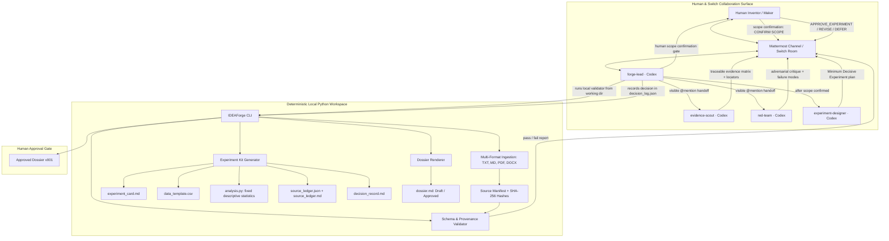

# IDEAForge 2.0 — Architecture & Dataflow



---

## 1. System Responsibilities

| Component | Primary Responsibility | Explicit Prohibition |
| --- | --- | --- |
| **Switch Room & Mattermost** | Shared communication, visible multi-agent context, agent handoffs, human interaction | Does not execute tools or store the only durable case data |
| **forge-lead** | Intake, verbatim wording preservation, handoff coordination, room synthesis, validator runner | Never invents citations or legal conclusions; cannot finalize without human approval |
| **evidence-scout** | Ingested source inspection, claim extraction, exact line/page locators, limited overlap matrix | Never cites documents not in the manifest; never invents page numbers |
| **red-team** | Independent adversarial critique, failure modes, competing mechanisms, confounders | Cannot simply agree; must provide testable failure mechanisms |
| **experiment-designer** | Minimum Decisive Experiment design, variables, equipment, calibration, BOM, decision criteria | Never fabricates prices or claims an experiment was run; must downgrade if MDE rationale is absent |
| **IDEAForge CLI** | Cryptographic SHA-256 hashing, document extraction, provenance validation, Experiment Kit generation | Never runs arbitrary LLM code; offline deterministic execution only |
| **Human Maker** | Problem constraints, critical uncertainty confirmation, final approval | Cannot be bypassed; final dossier requires explicit human command |

---

## 2. Directory Layout & Storage Architecture

```text
workspace/
└── IF-YYYYMMDD-NNN/
    ├── case.json
    ├── sources/
    │   ├── original/           # Untouched raw source files
    │   ├── extracted/          # Extracted line/page-aware text
    │   └── source_manifest.json # File hashes, locators, extraction metadata
    └── versions/
        ├── v001/
        │   ├── 00_idea_brief.json
        │   ├── 01_evidence_matrix.json
        │   ├── 02_critical_review.json
        │   ├── 03_prototype_plan.json
        │   ├── validation_report.json
        │   ├── decision_log.json
        │   ├── dossier.md
        │   └── experiment_kit/
        │       ├── experiment_card.md
        │       ├── experiment_plan.json
        │       ├── data_template.csv
        │       ├── analysis.py
        │       ├── source_ledger.md
        │       ├── source_ledger.json
        │       └── decision_record.md
        └── v002/               # Created upon revision; v001 is immutable
```
